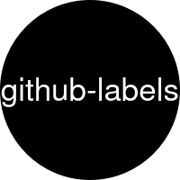

<p align="center">
  <a href="" rel="noopener">
  </a>
</p>

<h1 align="center">Update project labels in GitHub</h1>

<div align="center">

[](https://github.com/AlexSkrypnyk/github-labels/issues)
[](https://github.com/AlexSkrypnyk/github-labels/pulls)
[](https://github.com/AlexSkrypnyk/github-labels/actions/workflows/test-shell.yml)
[](https://codecov.io/gh/AlexSkrypnyk/github-labels)


</div>

---

## Features

`github-labels.sh` sets the labels of a GitHub repository to the list in [Labels](#labels):

- Creates the missing labels and updates the existing ones
- Deletes labels missing from the list, unless you add `--keep-existing`
- Updates the non-archived repositories of an organization or user, with `--exclude` to skip some
- Accepts `org/repo`, `org` or a GitHub URL as the target

## Installation

The script needs Bash 4 or later and `curl`. Download `github-labels.sh` from the latest release and make it executable:

```bash
curl -fsSLO https://github.com/AlexSkrypnyk/github-labels/releases/latest/download/github-labels.sh
chmod +x github-labels.sh
```

## Usage

To enter the repository and the token at prompts, run the script without arguments:

```shell
./github-labels.sh
```

To skip the prompts, set the token in `GITHUB_TOKEN`. Pass the repository as `org/repo` in the first argument or in `GITHUB_REPO`:

```shell
GITHUB_TOKEN=ghp_123 ./github-labels.sh myorg/myrepo
```

The first argument and `GITHUB_REPO` also accept a GitHub URL:

- A browser URL, such as `https://github.com/myorg/myrepo`
- A clone URL, such as `git@github.com:myorg/myrepo.git`
- An organization URL, such as `https://github.com/myorg`

```shell
GITHUB_TOKEN=ghp_123 ./github-labels.sh https://github.com/myorg/myrepo
```

The script exits before it sends a request when the URL points to a page inside the repository, such as `https://github.com/myorg/myrepo/issues`.

The script reads these environment variables:

| Variable                        | Default | Description                                                                                   |
|---------------------------------|---------|-----------------------------------------------------------------------------------------------|
| `GITHUB_REPO`                   | None    | Repository as `org/repo`, organization as `org` or either as a GitHub URL. Takes precedence over the first argument. |
| `GITHUB_TOKEN`                  | None    | Personal access token. The script prompts for it when empty.                                  |
| `GITHUB_DELETE_EXISTING_LABELS` | `1`     | If `1`, deletes every label missing from the list. `--keep-existing` sets it to `0`.          |
| `GITHUB_PROCESSING_DELAY`       | `3`     | Seconds to wait before the first label change. Press <kbd>Ctrl-C</kbd> to stop the script.    |
| `DEBUG`                         | None    | If `1`, prints every command the script runs.                                                 |

To keep the labels missing from the list, add `--keep-existing`. It works for a single repository and for an organization:

```shell
GITHUB_TOKEN=ghp_123 ./github-labels.sh myorg/myrepo --keep-existing
```

When the script can't create, update or delete a label, it carries on with the other labels and exits with `1`.

## Update every repository of an organization

To update every repository of an organization or user, pass its name without `/repo`:

```shell
GITHUB_TOKEN=ghp_123 ./github-labels.sh myorg
```

The script skips archived repositories. It lists the repositories it will update and asks `Update labels in N repositories? [y/N]` before it changes anything.

The repositories it updates depend on the owner type:

- For an organization, every repository the token can read, private ones included.
- For a user, the repositories the token's own user owns, so pass your own user name.

To skip repositories, list them in `--exclude`:

```shell
GITHUB_TOKEN=ghp_123 ./github-labels.sh myorg --exclude=myorg/repo1,myorg/repo2
```

Each entry is `org/repo` or its GitHub URL, in the organization you pass. The script exits before it sends a request on an entry from another organization or in another format.

To skip the confirmation, for example in CI, add `--yes` or `-y`:

```shell
GITHUB_TOKEN=ghp_123 ./github-labels.sh myorg --yes
```

When a repository fails, the script carries on with the remaining repositories. It then lists the failed ones and exits with `1`.

## Labels

The script applies these labels from the `labels` array in `github-labels.sh`:

| Label                | Color    | Description                                                                         |
|----------------------|----------|-------------------------------------------------------------------------------------|
| `BLOCKED`            | `D93F0B` | Issue or pull request is blocked                                                    |
| `AUTOMERGE`          | `934BF4` | Pull request has been approved and set to automerge                                 |
| `CONFLICT`           | `bc143e` | Pull request has a conflict that needs to be resolved before it can be merged       |
| `Dependencies`       | `62E795` | Pull request was raised automatically by a dependency bot                           |
| `DO NOT MERGE`       | `d93f0b` | Do not merge this pull request                                                      |
| `Do not review`      | `d93f0b` | Do not review this pull request                                                     |
| `Needs review`       | `5319e7` | Pull request needs a review from assigned developers                                |
| `Ready for test`     | `0e8a16` | Pull request is ready for manual testing                                            |
| `Ready to be merged` | `c2e0c6` | Pull request is ready to be merged (assigned after testing is complete)             |
| `Requires more work` | `b60205` | Pull request was reviewed and reviver(s) asked to work further on the pull request |
| `URGENT`             | `d93f0b` | Pull request needs to be urgently reviewed                                          |
| `UPSTREAM`           | `fbca04` | Issue or pull request is related to an upstream project                             |
| `A1`                 | `0E8A16` | Worker 1                                                                            |
| `A2`                 | `0E8A16` | Worker 2                                                                            |
| `A3`                 | `0E8A16` | Worker 3                                                                            |
| `A4`                 | `0E8A16` | Worker 4                                                                            |

To change the list, edit the `labels` array. Each label takes 3 strings: the name, the hex color without `#` and the description.

The array ends with GitHub's default labels, such as `bug` and `enhancement`, commented out. To keep a default label, uncomment it. The script then sets its color and description from the array.

The script matches label names case-insensitively. It renames an existing `blocked` label to `BLOCKED`, so the label stays on its issues and pull requests.

## Contribute

[`CONTRIBUTING.md`](CONTRIBUTING.md) lists the commands that install the dependencies and run the linters and tests.

---
_This repository was created using the [Scaffold](https://getscaffold.dev/) project template_
